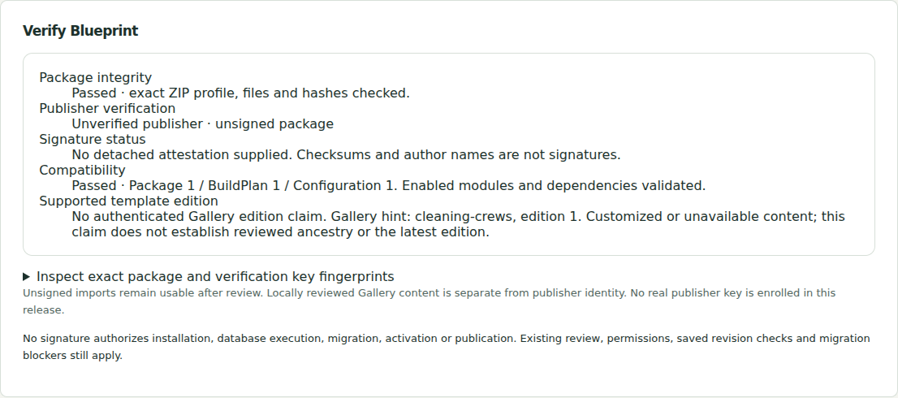
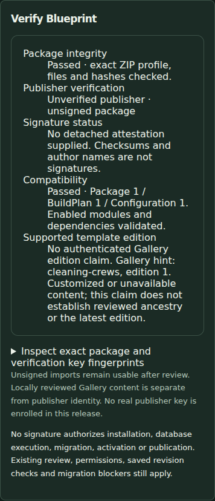
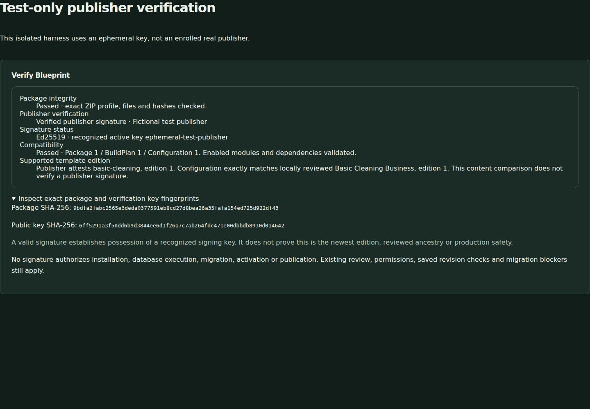

# Blueprint provenance verification evidence

PR #23 introduces detached attestation v1; ZIP v1/v2 and BuildPlan v1/v2 remain unchanged. Evidence below was measured on 2026-11-01 against source commit [`887d7ab61ca68633bf30cf4133cc521ada6f0bd7`](https://github.com/larrinamsalva/LMS/commit/887d7ab61ca68633bf30cf4133cc521ada6f0bd7), tree `9b46e175db1263037ce0a6e317306c2b0fcfac27`. The follow-up adds this evidence and captured PNGs only. Final-head checks are also linked in the PR.

## Foundation reviewed

| Existing boundary | Reuse/change |
| --- | --- |
| `blueprint-archive.ts`, `blueprint.ts` | Unchanged bounded three-file stored-ZIP reader/writer, canonical encoding, strict BuildPlan/module/dependency validation, summary and compatibility checks |
| Gallery and immutable history snapshots/source locks | Unchanged reviewed data/digests; existing history reader validates editions and exact plan-content comparison. JSON import attributes added for Node/Playwright compatibility |
| BusinessConfig, branding, manifests | Unchanged v1/v2 rules; no new configuration or package envelope version |
| Studio review, unsaved choices, Engine previews | Reused existing acceptance, quotas/cache, impact review and explicit publication. Adds optional detached file and verification status before review |
| Engine/SQL roles, isolation, draft/configuration history and audits | Unchanged; shared integration assertions run against both PGlite and real forced-RLS PostgreSQL |
| Auth/recovery, lineage/checkpoints, native readiness/copy lifecycle | No implementation changes, activation bypass or modified applied SQL/checksum; complete regressions run |

The registry starts empty. `esbuild` was already locked/installed through existing development tooling; it is now an explicit pinned development dependency for the isolated browser test bundle. No new installed dependency or license declaration was added (188 still verified).

## Tested boundaries

- Real Ed25519 signing and verification with **newly generated ephemeral test keys**, explicitly supplied as test-only trust. No real publisher identity/key has been established or signed a release.
- Unchanged v1 fixture and branded v2 exact ZIP round trips; canonical payload/file bytes, independent Node signer and browser Web Crypto verifier.
- Altered valid ZIPs, forged signatures, unknown/retired keys, unsupported algorithm/version, incompatible signed claims, unsafe signed modules/dependencies, malformed/duplicate/extra/unsafe JSON, Unicode/BOM/size limits and input/trust snapshot races.
- Host signing helper: private owned files/directories, correct public/private pairing, exact independently reviewed digest, explicit confirmation, no overwrite, interrupted partial output refusal and secret-free detached output. Actual CLI unsigned inspection and default-registry signing refusal. Successful CLI signing under a real enrolled key is **not** claimed.
- Shared Engine integration and native PostgreSQL forced-RLS tests: verification changes no records, audits or configuration; staff/viewer/other organization cannot save/publish; populated customer schema still blocks; stale saved revisions refuse; histories and the other organization remain intact.
- Actual Studio browser import: unknown claims and unsupported algorithms/oversized files refuse without modifying saved drafts/configuration/records; deliberate unsigned import displays accurate integrity/compatibility/publisher status and retains normal preview/use-as-unsaved controls.
- Positive browser crypto/component test: intercepted test-only page bundles the **same verifier and status component**, passes an ephemeral public test registry explicitly, and checks verified status, forged/retired refusal and accessibility in both themes across all viewports. It installs no app route, no public trust switch and no private key in browser code. This does **not** claim a positive real-publisher Studio import, since the shipped registry is empty.

## Final results

All jobs in [LMS quality run 41350620304](https://github.com/larrinamsalva/LMS/actions/runs/41350620304) completed successfully:

| Check | Actual result | Evidence |
| --- | --- | --- |
| Local `npm run check` (Node 24.22.1) | 200 tests / 33 files; types, 188 license declarations and optimized build passed | Full local run; targeted protocol/signing rerun also passed 13 tests / 2 files after the canonical protocol vector addition |
| GitHub foundation | 200 tests / 33 files, 51.79s; types, 188 licenses and optimized build passed | [Job 124979770561](https://github.com/larrinamsalva/LMS/actions/runs/41350620304/job/124979770561) |
| GitHub PostgreSQL | **170 tests / 13 files**, 94.63s; PostgreSQL/pg_dump 16.15 | [Job 124979770487](https://github.com/larrinamsalva/LMS/actions/runs/41350620304/job/124979770487) |
| GitHub Chromium | **66 passed**, 6.3m; desktop 1440×1000, tablet 810×1080, phone 390×664 | [Job 124979770279](https://github.com/larrinamsalva/LMS/actions/runs/41350620304/job/124979770279) |

Browser tests include axe WCAG 2 A/AA and 2.1 AA scans, overflow checks, readable light/dark forms, keyboard cancellation, actual Engine previews, unsigned v1/v2 import/re-export and unchanged source/draft snapshots. The intercepted positive crypto harness creates no demo session and does not raise preview/session limits. No real publisher private key is generated, committed, sent to the browser or enrolled.

The native job ran all existing account/session/ownership, recovery, lineage/checkpoint publication, scheduling, workforce, pricing, inventory, BuildPlan/history/branding/planner/rehearsal, backup/restore, native readiness and private copy lifecycle coverage. Its new signed-package assertion confirms unchanged source records/configuration, protected histories, populated-schema refusal, current draft revision checks and cross-organization/role boundaries. The local environment did **not** run a native PostgreSQL server: native/restore claims come from this actual CI job, not PGlite or simulated shell commands.

## Captured screens

Actual Studio unsigned import, desktop light theme:

Actual Studio unsigned import, phone dark theme:

Same verifier/status component with **ephemeral test-only trust**, not a real enrolled publisher or public trust-upload flow:

## Demonstration and limits

Download a customized fictional Gallery ZIP, import it with no attestation, choose **Verify Blueprint**, review the unverified-publisher status and features, then prepare the real isolated preview. Cancel or use it as unsaved choices; the browser test checks source records, saved drafts and published configuration before/after. Supplying a test-signed file to the actual shipped Studio refuses as **Unknown publisher key**. Clearing that claim deliberately allows only an unsigned/unverified retry, never an authenticated fallback.

For maintainers, `npm run blueprint -- inspect ZIP` was run through the actual CLI. Private-file signing and public-key verification were exercised end-to-end through the host signer with explicit ephemeral test trust. Default CLI signing was exercised and refused because no real key is enrolled. Successful CLI signing or Studio verification of a **real** publisher is not claimed. Separately reviewed real identity/enrollment/custody and a fictional acceptance signature remain prerequisites.

Older valid signed packages may still verify under an active key. A signature is not a latest-version receipt, trusted timestamp, ancestry proof, code-review endorsement or production/migration authorization. Retired-key knowledge depends on distributing the reviewed registry release; compromise/rollback of all application/registry anchors is not solved. See the [complete protocol and failure model](blueprint-provenance.md).
