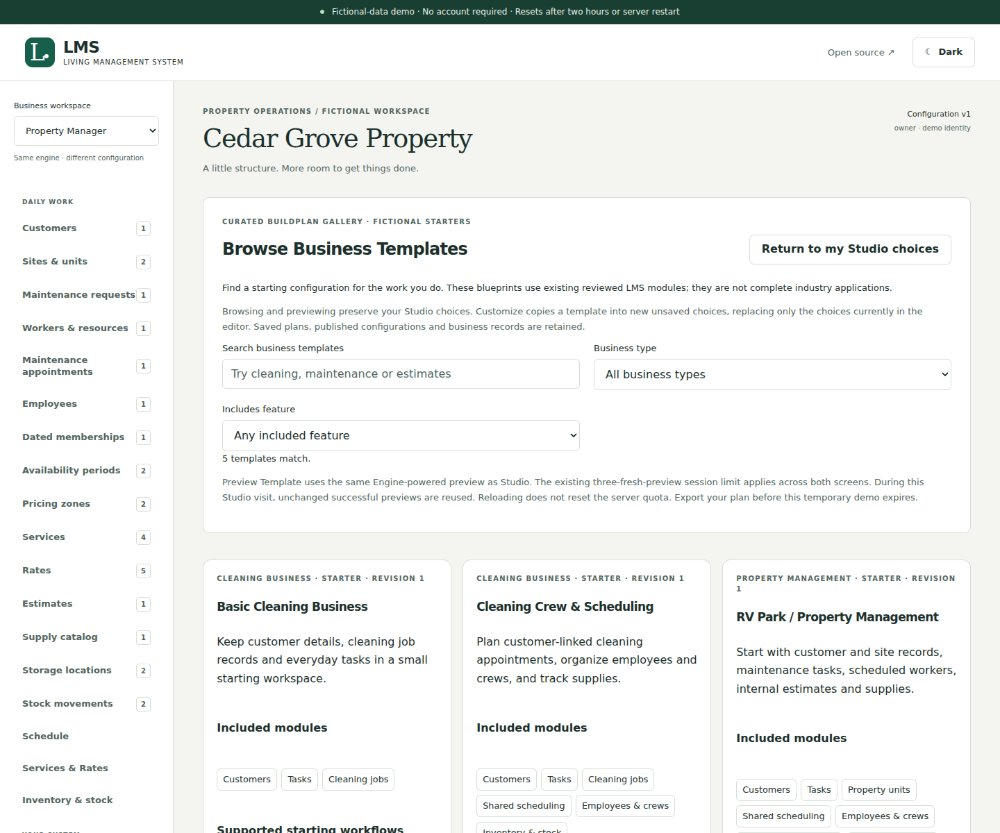
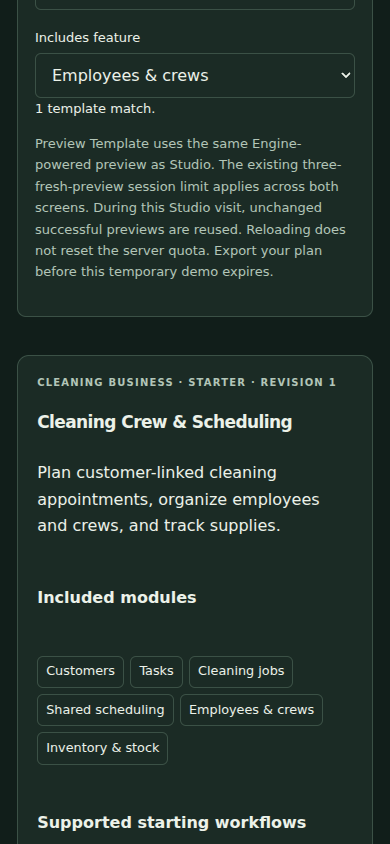

# BuildPlan Gallery foundations

**Browse Business Templates** offers five curated starter configurations inside BuildPlan Studio. Each uses the existing reviewed modules, strict BuildPlan validator, shared Engine and real workspace UI. A starter is a set of configuration choices, not a complete specialized business product. The public no-login demonstration stays fictional, isolated and temporary.

## Try it locally

```sh
npm ci
npm run dev
```

Open http://127.0.0.1:3000 → **Build My Business System** → **Browse Business Templates**.

1. Search by name, purpose or supported workflow. Combine **Business type** and **Includes feature** filters. Feature filtering uses enabled modules, not disabled features you could add later. Clear filters to return to the whole collection.
2. Read a card's included modules/workflows and its **Dependencies included** and **Scope and limitations** disclosures. Planned finance, messaging, AI, deployment and community-marketplace capabilities are not enabled by any template.
3. **Preview Template** prepares a new fictional workspace through the existing preview mechanism. Open its link in a new tab and try the shared generated forms. Basic Cleaning deliberately has no Schedule/Crews/Rates/Inventory screens; the crew starter enables the shared workforce/scheduling modules. Previews begin empty; enter made-up records only.
4. Return to the original tab. **Return to my Studio choices** preserves the current plan. **Customize This Template** deliberately replaces only the unsaved editor choices with a detached validated copy and starts a new draft intent. It does not save, publish, replace a business or edit prior draft history.
5. Use the existing Studio controls for name, features, terminology, navigation and supported optional fields. Required dependencies are automatically selected and explained; unsupported features remain unavailable.
6. Review current-workspace impact, save a draft, and export BuildPlan JSON or configuration JSON. Reopen or import the BuildPlan through Studio. Gallery metadata is not added to the portable envelope. Publishing remains a separate explicit action requiring a saved current review; identity differences or changes to populated fields still refuse.

## Reviewed collection

| Starter | Enabled modules | Scope limits |
| --- | --- | --- |
| Basic Cleaning Business | Customers, Tasks, Cleaning jobs | Descriptive job records; scheduling, crews, rates/estimates and stock are off |
| Cleaning Crew & Scheduling | Customers, Tasks, Cleaning jobs, Scheduling, Workforce, Inventory | Requires dated memberships and finite working hours for staffed bookings; rates/estimates, payroll and recurrence are off |
| RV Park / Property Management | Customers, Tasks, Property units, Scheduling, Workforce, Estimates, Inventory | No reservations, occupancy, leases, rent, meters, utility billing, invoices or payments |
| Property Maintenance | Customers, Tasks, Property units, Scheduling, Inventory | Resource-only reservations; add Workforce for employee availability; rates/estimates are off |
| General Service Business | Customers, Tasks, Scheduling, Estimates, Inventory, Custom records | Generic work items and notes; Workforce is optional; no specialized industry automation or live financial actions |

Estimates are fictional internal drafts, inventory uses whole individual units, and the existing scheduling/workforce limits still apply. Enabling a feature through Studio does not remove those module restrictions.

## Metadata, validation and updates

`src/core/gallery.ts` defines reviewed collection metadata separately from each existing portable `BuildPlan`. `GalleryEntry` wraps `{metadata,plan}`. Metadata has an ID, reviewed revision, name/purpose, allowlisted workflow IDs and limitations. Its revision identifies the curated edition; it is not a saved-draft revision or an engine schema version.

The collection is constructed from the same property/cleaning/custom builders and `selectModules`, then every entry passes `validateBuildPlan` and gallery validation at module load. Required manifest and work-reference dependencies are resolved deliberately when authoring a starter. A final plan with missing dependencies, unknown module/version, altered core schema or a workflow requiring a disabled module refuses. Duplicate IDs/claims and unsupported metadata properties also refuse. There is no external registry, executable plugin, downloaded template, upload-to-gallery endpoint or arbitrary preview URL.

`reviewedGallery()` and `remixGalleryEntry()` return detached copies. Saving stores the ordinary complete BuildPlan snapshot under the existing draft/revision rules, never a live reference to a gallery ID. A later gallery revision cannot silently update saved choices. There is no automatic update/subscription operation. Future incompatible template versions need an explicit reviewed compatibility process; existing imports must refuse rather than silently migrate or rewrite populated schemas.

The [blueprint package extension](blueprint-packages.md) retains an optional Gallery ID/revision hint outside BuildPlan v1. Studio can compare customized choices with the currently bundled reviewed starter, including a newer revision when available. A package hint is unverified, never proof of origin; comparison neither merges choices nor overwrites saved plans. Export a ZIP to retain package-only details; plain saved drafts still store configuration only.

[Template history and safe update review](template-history.md) retains immutable reviewed editions and separately pinned digests. Gallery defaults remain edition 1 in this phase; Basic Cleaning and Property Maintenance have explicit newer editions through **Check for Template Updates**. Exact saved starting-point content enables three-way comparison; unknown roots and imported hints remain informational. Every selected replacement requires review and becomes unsaved choices before the existing save/publication steps. This does not provide authenticated portable provenance or automatic migration.

Adding a curated entry requires a source-code review: choose existing modules, resolve dependencies, declare only workflows backed by enabled modules, provide honest limitations, and run gallery, Engine, PostgreSQL and responsive browser checks. Do not change the portable envelope to carry gallery branding/provenance without a separately justified backward-compatible design.

## Previews and security

Gallery and Studio call the same private in-memory demo preview provisioner and use the existing same-origin/session/organization checks. The **three fresh previews per demo session** limit is unchanged across both screens. Successful validated plan content shares a preview URL during one mounted Studio visit, so previewing a template and then customizing unchanged choices does not create a second sandbox. Original operation IDs retain the existing retry behavior. Reopening a preview retains its fictional records; it does not reset the database.

Leaving Studio or reloading loses its client URL cache and unsaved editor state; it does not reset server quotas. Save/export choices and use the existing preview workspace selector when needed. Slot exhaustion gives the existing explanatory error; no quota override or unblocking action exists. Browsing, searching, previewing and customizing do not publish a configuration or save a draft automatically.

All draft/RLS/role protections, migration impact checks, audit/configuration history, recovery/credential/checkpoint gates and native restoration blockers remain unchanged. No database migration, new HTTP endpoint, persistent-business route, production account, deployment, purchasing, payment, message or ForgeOS change is added. MIT licensing and upstream attribution remain. [Studio workflow](buildplan-studio.md) · [Security](../SECURITY.md) · [Roadmap](../ROADMAP.md).

## Verification

See [test evidence](buildplan-gallery-verification.md). Browser screenshots are captured from the running application; the automated gallery flow covers search/filtering, disabled screens, real record creation in a preview, preview reuse, unsaved remixing, customization, save/export/reopen/import, quota exhaustion and light/dark accessibility on desktop, tablet and phone.

## Application screenshots




