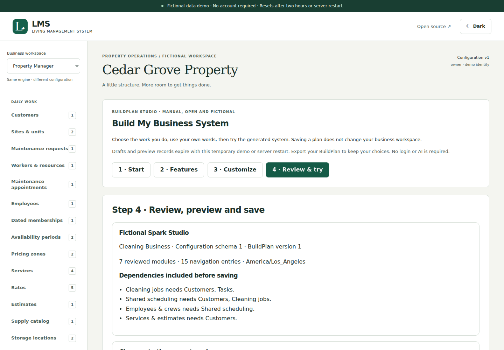
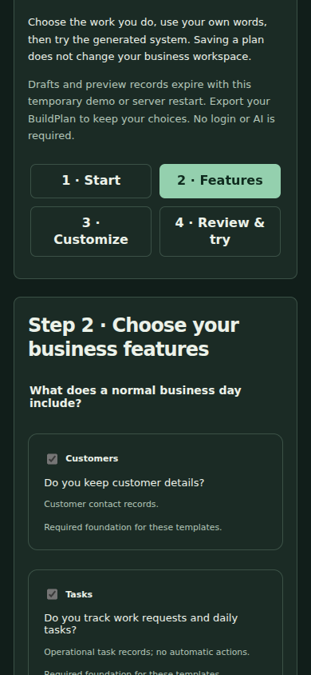
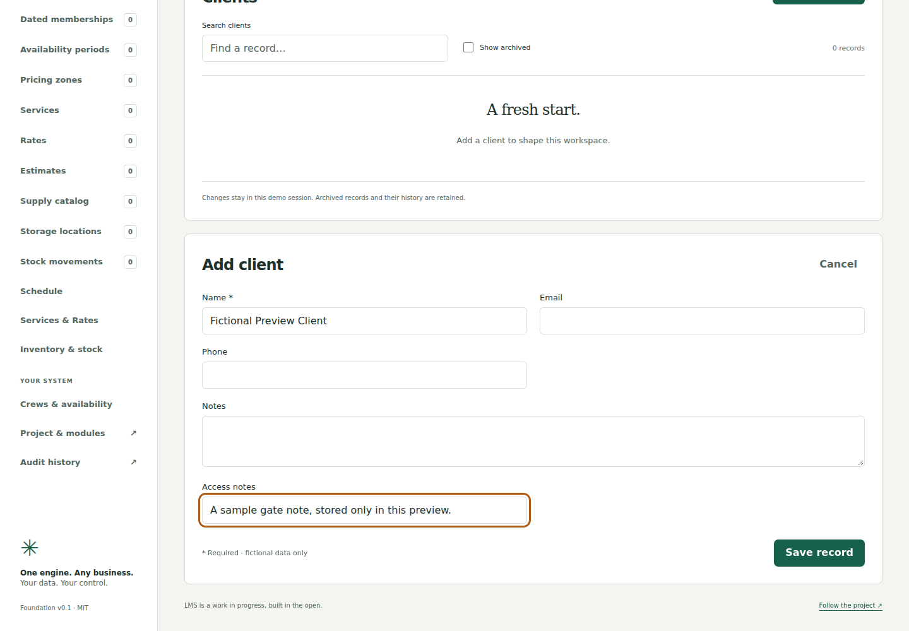

# BuildPlan Studio: visual configuration builder

BuildPlan Studio is the first working manual builder for the shared LMS engine. It generates a validated `BusinessConfig`; it does not create a separate industry application or deploy a service. No login, AI, paid service or external account is required for the temporary fictional demonstration.

## Demonstration workflow

From the repository root:

```sh
npm ci
npm run dev
```

Open http://127.0.0.1:3000 and choose **Build My Business System**, or open **BuildPlan Studio** in an existing fictional workspace.

1. **Start**: select Property Management, Cleaning Business or Custom Business. The existing workspace's compatible choices are initially loaded. Starting another template replaces only unsaved choices; saved drafts remain. Custom Business uses general customer/work-item records and the same shared optional modules.
2. **Features**: answer the operations questions on the module cards. Customers and Tasks are this phase's required foundation. Appointments, employees/crews, services/estimates and inventory reuse the reviewed registry. Dependencies are added automatically. A required feature explains which selected features depend on it; disable those dependants first. Scheduling also follows required work-record references, so cleaning appointments include Cleaning jobs.
3. **Customize**: enter a fictional name/time zone; change singular/plural terms, separate navigation labels and navigation order. Add up to four optional text, notes, email, date or operational-number fields to supported operational entities. Core field definitions and permissions stay locked. Optional fields still require a reviewed migration if their target is populated.
4. **Review & try**: inspect dependencies and effects on the current workspace. Studio lists identity changes, disabled modules, field changes, booking-zone effects and migration blockers. Its impact calculation is shared with Engine publication and includes archived/disabled populated entities.
5. **Prepare workspace preview**, then **Open interactive workspace preview (new tab)**. This provisions an empty, isolated fictional organization in the in-memory demo. The page is the actual shared `Workspace`, generated forms and Engine/SQL: add a made-up customer or work item and refresh to verify it. It is not a screenshot or hardcoded mock. Preview records do not appear in the original workspace. Your plan choices stay in the original tab. Previews open in a new tab to preserve the existing `frame-ancestors 'none'` protection.
6. Back in Studio, **Save BuildPlan draft**. Saving appends a draft revision, not a business configuration revision. Export **BuildPlan JSON** to keep reusable choices; export **configuration JSON** for the validated engine document alone.
7. Refresh/reopen Studio and select a saved plan. Import an exported BuildPlan JSON file to load a new unsaved draft. Compatible choices, extra-field identifiers, module versions and navigation labels survive a round trip. Older saved content can be reopened; a changed save appends after the latest draft revision.

For a portable name/description, compatibility metadata, setup summary and integrity checks, use **Download Blueprint Package**. Its separate **Import Blueprint Package → Review Blueprint** workflow requires explicit acceptance as unsaved choices and keeps existing BuildPlan v1 JSON unchanged. Package-only details travel in the ZIP/current editor, not saved draft envelopes. [Package workflow and format](blueprint-packages.md).
8. If you want to apply compatible choices to this fictional workspace, save the unchanged plan, explicitly confirm publication, and choose **Publish reviewed BuildPlan**. This calls the same Engine publication transaction as Project & modules. Existing configuration history/rollback remains there. A stale review must be explicitly reviewed against the current configuration and saved again.

The cleaning preview can change Customers to Clients, add an Access notes field, and save a client through the shared form. The property workspace can publish a compatible business-name/navigation change and restore a previous configuration. The Custom Business preview can create general work items through the same record engine. See [actual verification](buildplan-studio-verification.md) and screenshots below.

## Safe choices and imports

A portable BuildPlan is strict JSON with `format: "lms-build-plan"`, `version: 1`, `engineApi: 1`, `templateVersion: 1`, a property/cleaning/custom `template`, and `configuration: BusinessConfig` schema 1. Its configuration goes through the existing engine validator and a bounded reviewed-template contract. Imports are validated, never dependency-repaired silently. Only deliberate feature choices invoke dependency resolution.

Only known module IDs/versions/capabilities and template entities are accepted. Template industry, core field identities/types/requiredness/options/references and entity identity/title fields remain reviewed. Added fields must be optional, use a generated `extra_` key and one of the five supported types, and target customers, work/tasks, jobs, units or custom notes. A builder-generated Custom notes entity is available via Custom records. Modules may be disabled while retaining their entity definitions and data.

Business names, terminology and navigation labels are bounded text rendered by React, not HTML or executable templates. Studio does not accept scripts, expressions, arbitrary modules, URLs, executable plugins, SQL, credentials, organization memberships or ownership changes. Unknown properties, unsafe object keys, unsupported versions, missing dependencies, malformed JSON, oversized files and changed core fields refuse. Input files/canonical envelopes are bounded to **48 KiB of UTF-8**. Raw `BusinessConfig` JSON is a separate export, not a BuildPlan import. Never rename an arbitrary application export into a BuildPlan and expect it to load.

All existing module validators still apply, including exact pricing, stock quantities, scoped relationships and scheduling/workforce constraints. Studio cannot add a finance action or bypass an activation blocker. Production authentication/business HTTP routes remain unmounted.

## Draft, publication and concurrency boundaries

Migration **011_build_plan_studio.sql** adds `lms.build_plan_revisions`, separate from operational records and `config_revisions`. It has forced RLS, owner/admin read/insert policies, scoped configuration-version foreign keys, no runtime UPDATE/DELETE grants, an append-only revision guard and the existing audit trigger. Staff/viewers cannot read or save drafts. The existing organization epoch orders draft insertion/raw writers with configuration/record changes and rejects stale REPEATABLE READ writers.

The database validates envelope/size/version/revision bounds and authoritative actor/time. The TypeScript Engine validates the full configuration/template contract; raw SQL is a trusted host boundary, as for the existing configuration API. Stored artifacts are revalidated on reopening/publication. An unsupported artifact is never executed or auto-published. A database superuser remains trusted; this is not administrator-compromise protection.

A draft ID plus its expected prior revision identifies a save intent. Identical retries return the original append without another audit; a changed retry or stale/conflicting save refuses. Drafts keep the configuration revision they were reviewed against. Five plans per organization and twenty append-only revisions per plan bound the temporary demo. Copying choices to a new plan retains the old history and requires an available plan slot.

Publication requires the latest saved draft revision, the matching review/configuration revision, explicit confirmation and current owner/admin permission. It reuses the Engine's publication transaction and impact rules; it never rewrites populated fields. Concurrent record creation or configuration changes are checked again under the existing lock/SQL guard. A different starter identity cannot overwrite the current project; use a new preview/export. Adding even optional fields to populated data requires a separately reviewed migration. Disabling a module retains its records. Rollback still appends history and refuses any incompatible populated-schema change.

The native write gate is installed on draft inserts when the recovery/control schema is present. After supported restore, normal startup and raw runtime draft writes remain blocked. Native backup/restore includes draft/configuration/audit history. Nothing in Studio repairs or bypasses recovery, credential lineage or checkpoint publication requirements.

## Temporary preview isolation and expiry

The only HTTP transport remains the existing bounded, same-origin `/api/demo`, using its HttpOnly opaque session cookie and server-created principal. Plan commands first verify that the requested organization belongs to that demo session. The preview provisioner always uses the private in-memory database; it does not accept a connection string or attach the host-only persistent adapter. New previews have no real accounts, invitations or records.

Each session may create **three fresh previews** in addition to its original two businesses. Creation reserves slots before awaiting; identical operation UUID/input retries reuse the same result, and changed requests using that UUID refuse. Failed creation is transactional and releases its slot. Existing previews remain available until session expiry/restart; they are not silently reset when you change choices. A later preview is labelled as earlier choices if its configuration differs from the current plan.

The existing 24-session, two-hour, 250-record/workspace and 40-configuration-revision caps remain. Draft quotas are separate. Session expiry revokes access and trusted host cleanup retires whole temporary organizations, including their plans and stock. Migration 11 fixes the stock guard's expiry-cleanup edge case: it allows a source-row cascade only after its parent organization has already been deleted. Runtime cannot delete organizations. Direct stock-row edits/deletes/archive still refuse; no force flag or public cleanup endpoint exists. The native and embedded tests cover this boundary.

## Setup, review and next phases

The no-login demo needs no database/environment credentials. For the optional native backend, follow [PostgreSQL setup](postgres-setup.md), back up the explicitly named fictional database, stop all runtime/auth hosts and run the existing `db:migrate` command. Migration 11 takes the existing exclusive maintenance/table locks and commits with the checksum ledger. Applied SQL 1–10 is unchanged. No old records/configuration, stock, memberships or audit history is rewritten; no plan is fabricated. New draft writes refuse on databases missing migration 11.

The separate [curated gallery](buildplan-gallery.md) now provides five bundled starting configurations. This phase still excludes community galleries/marketplaces, AI generation, branding uploads, arbitrary new entities/core field editing, data migrations, business-data import, real-user account acceptance, external hosting, automatic deployment and production recovery activation. Manually extended legacy configurations outside the reviewed templates are preserved by the existing editor; Studio explains when it must start fresh template choices. Physical devices/assistive technologies and deployment packaging need separate acceptance.

The separate blueprint package phase adds strict local packaging and informational compatibility comparison. Next: reviewed provenance/history, branding, explicit configuration migrations, executable application packaging, business-module extensions and the later community gallery/AI tracks. [Roadmap](../ROADMAP.md) · [Security](../SECURITY.md) · [API](api.md).

## Screenshots

These are captured from the running fictional application, not generated mockups.






