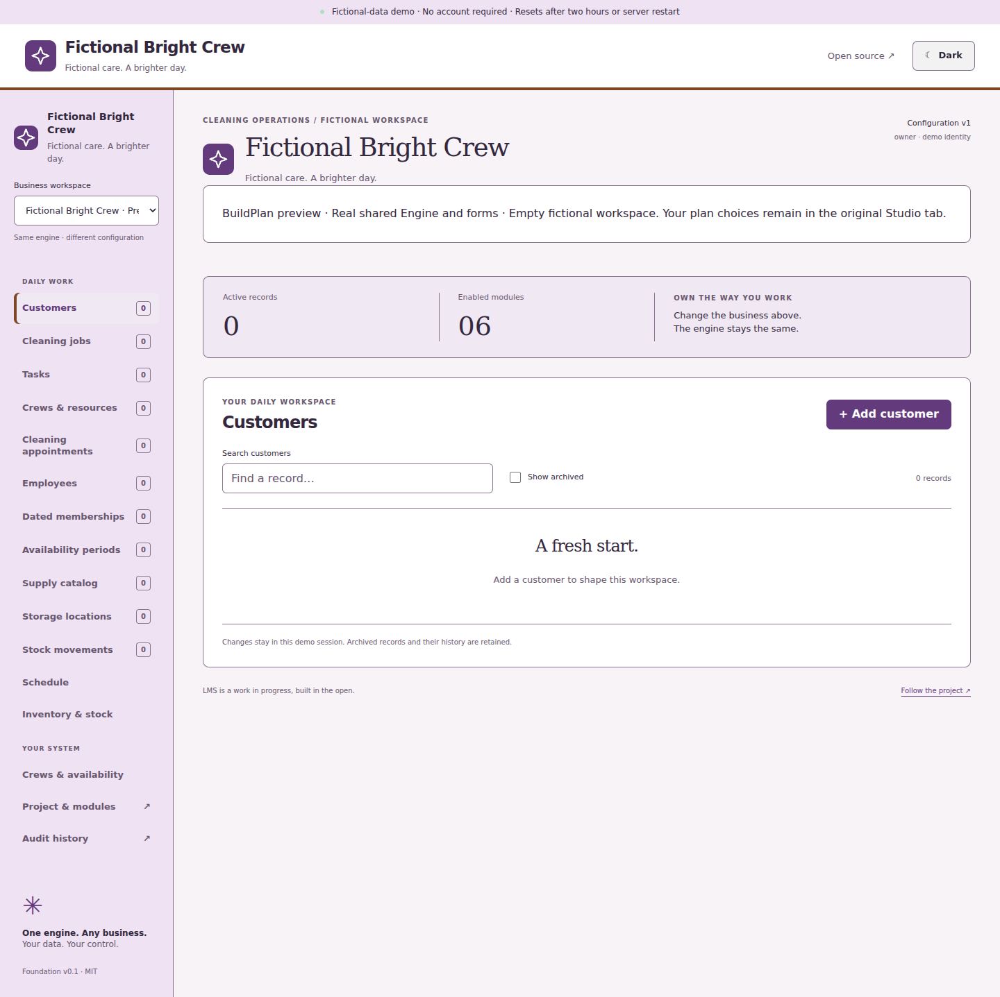
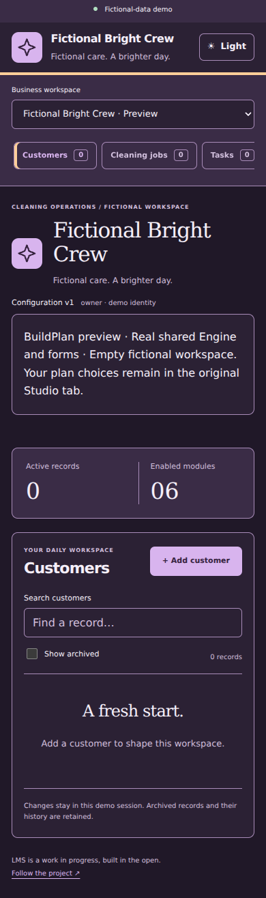

# Business Branding Studio

Branding changes presentation through the shared configuration Engine. It never edits customer, estimate, stock, scheduling, employee, membership or credential records. The no-login demo stays fictional, isolated and temporary. No upload, hosting service, font download, production authentication or deployment is added.

## Try it

1. Open **Build My Business System → Browse Business Templates** and customize a cleaning, property or general-service starter.
2. Open **Customize → Brand Your Business**. Set **Business name**, the existing configuration display name used in the workspace header.
3. Enable **Include business branding in this BuildPlan**. Enter an optional tagline and 1–4 uppercase letters/numbers for your monogram. Choose a reviewed logo mark.
4. Choose **Forest & linen**, **Ocean & cloud**, **Plum & pearl** or **Copper & sage**. Each provides primary, secondary and accent colors, paired with readable light and dark variants. Both identity samples update immediately. Arbitrary hex values, CSS and independently mixed colors are deferred; the reviewed palettes are coordinated sets.
5. Select the default **Light** or **Dark** appearance. A viewer's previously saved theme preference takes priority; the workspace's theme toggle remains available. A business cannot force a viewer to discard that preference.
6. Open **Review & try → Prepare workspace preview**. This creates an empty fictional workspace through the real Engine, using the same forms, modules, marks and tokens. The existing three-preview session quota applies. Unsaved choices do not restyle the original workspace.
7. **Save BuildPlan draft**, export its JSON or **Download Blueprint Package**. Reopen a saved revision or import the JSON/ZIP to recover the same branding. Package imports still require **Review Blueprint → Use as unsaved Studio choices**.
8. To change a compatible existing fictional workspace, save an unchanged draft, review its impact, check the explicit publication confirmation and choose **Publish reviewed BuildPlan**. Project & modules retains configuration history and rollback. Different project identities and populated field-schema changes still refuse.

Disable **Include business branding** to deliberately return the editor to legacy BuildPlan/configuration v1 and the original LMS appearance. This is an unsaved choice until explicitly saved/published. Existing branded draft/history revisions remain intact.

## Supported identity areas

The dashboard displays the business name, tagline and mark. The top bar and desktop sidebar reuse the same identity component. Primary color is used for buttons, links, marks and navigation text; secondary color for sidebar/identity surfaces; accent for the header edge, selected navigation indicator and focus ring. Themes supply matching foreground/background pairs. The mobile sidebar keeps its compact navigation; the business identity remains in the top bar/dashboard. System attribution and the fictional-data banner remain visible.

Critical warnings, financial acknowledgements and other semantic status colors retain their reviewed meanings. Branding cannot rename roles, change permissions, alter a form's business contract or authorize an operational action.

## Explicit version and compatibility contract

| Artifact | Existing unbranded contract | Branded extension |
| --- | --- | --- |
| `BusinessConfig` | `schemaVersion: 1`, no `branding` key | `schemaVersion: 2`, required `branding` version 1 |
| BuildPlan JSON | `version: 1`, configuration schema 1 | `version: 2`, configuration schema 2 |
| Blueprint ZIP | Manifest `version: 1`, BuildPlan/configuration 1 | Manifest `version: 2`, BuildPlan/configuration 2, `compatibility.branding: 1` |
| Shared Engine/modules/templates | Engine API 1, template version 1, module version 1.0.0 | Unchanged operational interfaces/contracts; presentation is versioned separately |

No automatic upgrade of a Gallery starter, saved draft, import or published configuration occurs. Existing reviewed starters remain detached v1 plans with their original default LMS appearance. Enabling branding recommends Forest for property, Ocean for cleaning and Plum for custom businesses; users can select any reviewed palette on their own copy.

The schema-2 extension is strict:

```ts
branding: {
  version: 1,
  palette: "forest-v1" | "ocean-v1" | "plum-v1" | "copper-v1",
  mark: "monogram" | "home" | "sparkle" | "leaf" | "tiles",
  monogram: string, // /^[A-Z0-9]{1,4}$/
  tagline?: string, // trimmed plain single line, at most 120 characters
  appearance: "light" | "dark"
}
```

The display name remains top-level `configuration.name` (1–80 characters); branded names/taglines reject markup delimiters and control characters. Branding accepts no extra properties, color strings, CSS, HTML, image URLs, SVG payloads, scripts, tokens or operational data. Built-in marks are static, reviewed JSX geometry; user text is escaped by React. CSS values originate exclusively from versioned constant palettes. Each palette ID/token map is immutable; future color revisions need a new reviewed ID.

Package v2 retains the same three fixed files, stored-ZIP profile, canonical JSON, byte limits and SHA-256/CRC checks as [package v1](blueprint-packages.md). Its manifest binds BuildPlan 2, configuration schema 2 and branding 1. Its summary adds the saved mark/monogram/tagline/palette/default appearance. V1 summary bytes are unchanged: a checked-in ZIP generated from merged PR #16 (`49fd309`) is imported and reproduced byte-for-byte in tests (SHA-256 `4b6f8a396f9ea59122b3a84de96f1fd7ad193b6b895e284e269f344d5b37e50d`). Downgraded/mismatched versions and unsafe branding refuse even after hashes are recomputed.

Older applications that support only v1 must reject branded v2 rather than discard it. Upgrade before using branded artifacts. Exporting or explicitly reverting to legacy appearance is deliberate; no importer strips branding silently. Workspace data export keeps its existing outer envelope, with the nested explicit configuration schema version; it remains an export, not a database importer.

Branding lives **inside configuration**, so it survives draft revisions, JSON, packages, publication and rollback. Package-only blueprint name/description/Gallery hints still travel in the ZIP/current editor rather than draft envelopes; that separate PR #16 limitation is unchanged.

## Accessibility checks

Reviewed palettes are tested without rounding: normal text/muted/link colors against all supported surfaces meet at least **4.5:1**; button/brand foreground pairs meet 4.5:1; focus/border indicators against adjacent surfaces meet **3:1**. These checks use the WCAG sRGB luminance formula, plus browser axe/keyboard/reflow checks on actual screens. They do not claim exhaustive screen-reader, physical-device or production certification. Sources: [W3C text contrast](https://www.w3.org/WAI/WCAG22/Understanding/contrast-minimum.html) and [non-text contrast](https://www.w3.org/WAI/WCAG22/Understanding/non-text-contrast.html).

## Persistent database upgrade

The temporary demo automatically creates a fresh database with migration 12. Existing host-only PostgreSQL databases require the reviewed migration; branding does not enable a persistent HTTP route.

1. Follow [PostgreSQL setup](postgres-setup.md); create a native backup of the explicitly named fictional database.
2. Stop **all** business/authentication hosts. Migration 12 takes the existing exclusive maintenance lease and nonwaiting source-table locks.
3. Run the existing local command, using its configured separate administrator and exact fictional name:

   ```sh
   npm run db:migrate -- --database lms_development
   ```

4. Verify migration `012_business_branding`, then rehearse branding and rollback on fictional records before normal host-only use. No down migration or manual blocker removal is supported.

Migration 12 validates existing configuration adoption, expands the schema discriminator and replaces only the BuildPlan version/branding check while retaining actor/role, organization epoch, immutable revision, quota, audit and online-write controls. Its private validator/trigger functions have empty search paths and no PUBLIC/runtime execution grants. Unsafe branding is rejected through SQL as well as the Engine. The full operational/template validator remains in TypeScript, under the existing trusted-host raw-SQL boundary; the database branding validator is not a second business engine.

Installation and its checksum ledger are atomic. No existing configuration, draft, record, membership or audit is rewritten. Databases missing migration 12 refuse branded writes. Native tests rehearse attached-host refusal, installation failure rollback, upgrade preservation and backup/restore of both legacy and branded history. Every supported restored database remains activation-blocked.

## Limits and next phases

This phase offers coordinated palettes and built-in marks/ASCII monograms only. Secure custom image upload requires separately reviewed content decoding/re-encoding, pixel/byte limits, metadata stripping, scoped private storage, authorization, retention, CSP and accessible fallback behavior. None of those controls is replaced by a public URL or inline SVG shortcut here.

There are no external themes/fonts, logo upload, public media hosting, executable app export/deployment, real-business authentication, automatic template updates, payments, messaging or recovery activation. Publisher provenance, production acceptance, image custody and richer visual customization remain separate phases. MIT and ForgeOS attribution are retained. [Verification](business-branding-verification.md) · [Roadmap](../ROADMAP.md).

## Running-application examples




