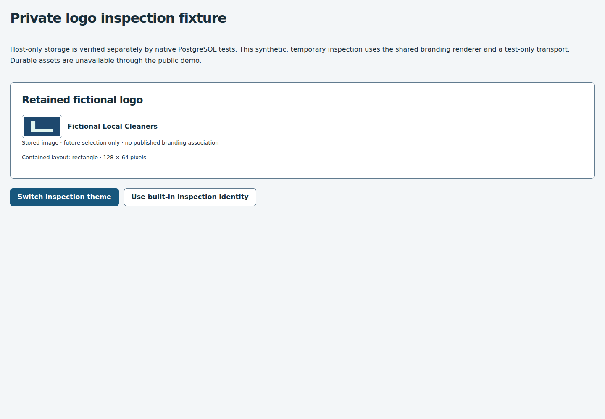
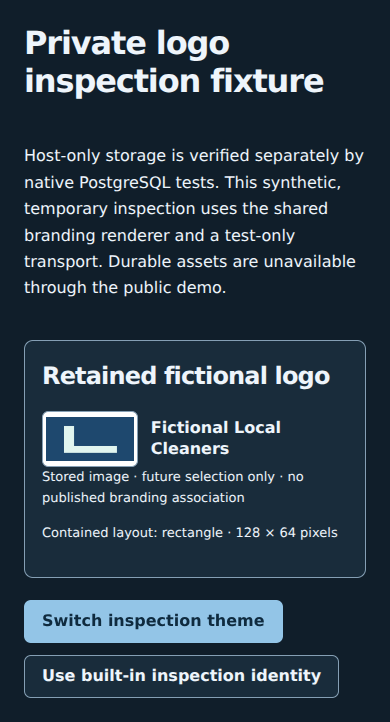

# Durable private logo verification

This PR is host-only library/test tooling. No persistent public upload or native-storage UI is installed. The presentation fixture uses synthetic data and mocked browser transport; native PostgreSQL independently verifies actual storage and restoration.

## Coverage and commands

- Original sanitizer, exact PNG metadata/digest/profile, shared process-wide capacity, input/output/pixel/animation/security regressions.
- Actual SQL migration, forced RLS, narrow byte access, immutable identity/receipts/history, actor/instance guards, missing/stale commands, repeat/replacement/cleanup transitions and continued activation refusal.
- Real PostgreSQL: separate Node processes/reconnection, current roles/revocation, unknown/foreign IDs, exact retries, concurrent replacements/creates, quota exhaustion with retained bytes and cleanup headroom, corrupt content, unchanged business snapshots and compatible portable exports.
- Existing native backup coordinator: completed fictional restore, byte/history/ACL comparison and restored-runtime/asset-operation refusal. No failed/partial restore is reported as success.
- All previous credential/recovery/lineage/checkpoint, scheduling/workforce/pricing/inventory, branding/Studio/Gallery/template/package/migration/copy regressions remain required.
- Browser: existing public demo remains temporary and isolated; an additional no-session test-only renderer checks readable themes, responsive layouts, keyboard controls and missing-image fallback.

```sh
npm ci
npm run check
npm run test:postgres
npm run test:e2e
```

Network tests require the documented disposable fictional cluster and never silently skip. CI uses PostgreSQL and native clients 16.15. The unchanged screenshot artifact accepts only synthetic `custom-logo-*.png` files.

## Actual results

| Check | Verified evidence |
| --- | --- |
| Local `npm run check` | 242 tests / 39 files, type checks, 188 dependency licenses and production build passed |
| Local focused SQL/vault/processing checks | 17 tests / 3 files passed after intake snapshot hardening; type checks passed |
| Real PostgreSQL source `fc2a12d70b6214eb585e45a0944e210f2e6a0667` | All 186 tests / 14 files passed, including 16 new storage/restore cases; 117.11 seconds, PostgreSQL/pg_dump 16.15 |
| Source browser regression | All 72 desktop/tablet/phone cases passed in CI; includes the unchanged public demo and isolated presentation fixture |
| Local visual fixture | All 3 viewports passed (29.0 seconds), Axe, themes, keyboard and unavailable-image fallback |

[Native source CI](https://github.com/larrinamsalva/LMS/actions/runs/41371375211) · [Browser source CI](https://github.com/larrinamsalva/LMS/actions/runs/41370738404) · [PR #26 and final-head checks](https://github.com/larrinamsalva/LMS/pull/26).

These evidence snapshots identify earlier source revisions. The final suite additionally exercises intake-buffer/actor snapshotting before an asynchronous authorization wait. All final-head jobs must pass before review; use the PR's current checks/results rather than inferring final verification from these earlier counts. The initial native run caught an obsolete fixture which injected version 13 as an unknown migration; it now injects 14, retaining the refusal assertion. No security check was relaxed. The new private asset native round-trip actually completed, preserved retained bytes/history/ACLs, left the source unchanged and refused restored activation. This is not real-user/session, physical disk/power-loss, failover, encryption or production acceptance; the storage-failure case is a controlled SQL fault, not a physical-disk experiment.

## Limits

Only the trusted-host Principal boundary is supported. Per-request identity/session resolution remains the existing host adapter's responsibility; cached/browser-asserted principals are not accepted identity evidence. New tests demonstrate revoked business memberships; existing credential/session revocation regressions remain required. SQL storage checks do not replace native sanitization or protect against a malicious host/superuser. Self-stored SHA-256 is not independent authenticity, latest-version proof or encrypted custody. Bytes are retained in every lifecycle state; physical cleanup and portable published branding are intentionally unsupported.

[Workflow, exact contract and trust model](durable-private-logos.md)


## Presentation fixture screenshots

These synthetic examples use the shared branding components and a browser-test transport. They do not show a publicly accessible durable database UI. Native persistence/restoration is a separate test boundary.




