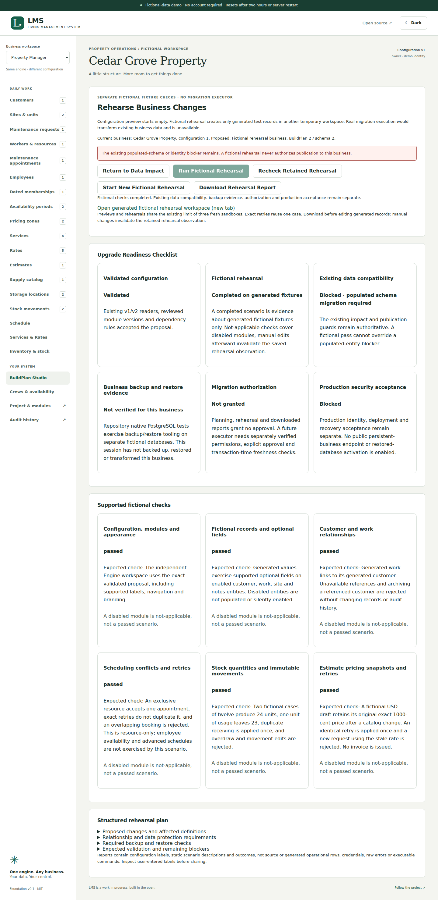
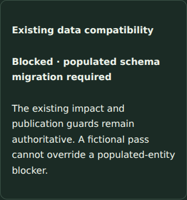

# Fictional rehearsal verification

PR #20 adds fixed fixture checks and an explicit readiness checklist. No historical SQL migration/checksum, database grant, persistent-business route, backup/restore implementation, credential/recovery/activation control, dependency or portable BuildPlan/package protocol changes. Existing empty-preview provisioning is shared; its quota is now shared with rehearsal cases. Expiry retains tracking until retirement succeeds.

## Coverage

- Unit tests validate the structured plan against existing readers/module dependencies, preserve legacy/branded version pairings, keep populated/archived-data and backup/authorization/production blockers independent of completion, reject unknown commands/forged outcomes and whitelist privacy-safe reports.
- Demo integration tests verify concurrent exact retries, source/draft/other-organization refusal, generated optional-field/branding fidelity, no copied private values, manual-edit invalidation, failed partial fixture retirement including immutable stock, static error sanitization, shared quota, expiry and source changes during execution.
- Shared embedded/native tests exercise fixed property and cleaning fixtures through the same actual Engine. Expected failures leave snapshots/audits unchanged; idempotent appointment, estimate and stock requests create no duplicate effects. Populated/archived sources, unauthorized actors, nonempty targets and malformed configurations refuse. Original source records/history remain unchanged.
- Two browser workflows cover all three viewport sizes: populated optional-field blocker, actual generated branded workspace, readiness separation, retained case/retry, private report, manual-edit refusal, explicit source refresh and disabled-feature not-applicable statuses. Light/dark axe, keyboard-accessible controls and overflow checks remain alongside every previous suite.
- Existing native dump/restore, migration failure/checksum, recovery, credential-lineage, checkpoint-publication and all business-module tests remain enabled. Their real CI results are evidence about bounded tooling regressions, never a verified backup or transformation of this session's business.

## Reproduce and actual results

```sh
npm ci
npm run check
npx playwright install --with-deps chromium
npm run test:e2e
# Disposable native PostgreSQL prerequisites: docs/postgres-setup.md
npm run test:postgres
```

Actual final-source counts, run/job links and environment limits are recorded in [PR #20](https://github.com/larrinamsalva/LMS/pull/20) and [its checks](https://github.com/larrinamsalva/LMS/pull/20/checks). Native prerequisites fail rather than silently skip. Local native PostgreSQL/Docker are unavailable; actual native restore claims require the GitHub PostgreSQL 16.15 job. Local browser checks use the existing temporary Chromium 153 executable override; CI uses normal Playwright Chromium.

Local Node 24.22.1 results:

| Check | Actual result |
| --- | --- |
| `npm run check` | 171 tests in 29 files, TypeScript, production build and 188 dependency license declarations passed |
| Final report semantics | Four unit cases and final production build passed after expected-check wording and guarded retry controls |
| Focused desktop flows | Two passed in 38.2 seconds, including actual generated workspace editing and subsequent report refusal |
| Complete responsive regression | All 63 browser tests passed across desktop, tablet and phone in 11.6 minutes, including light/dark accessibility checks |

Screenshots come from the actual fictional application and are visually inspected, not generated mockups. No real-data migration, production deployment, physical-device acceptance, external accessibility audit, durable/signed approval, business-specific backup, native migration executor or recovery activation is claimed.




