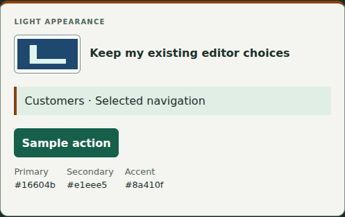
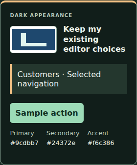

# Logo companion verification

This phase implements only unsigned device-portable assets and temporary demo custody. It does not implement image-bearing published branding, a new blueprint format, a real publisher enrollment or PostgreSQL media persistence.

## Coverage

- Strict companion v1: deterministic exact-byte/layout round trips; SHA-256 and actual PNG dimensions; forged metadata/MIME/publisher fields; unsupported versions; malformed/duplicate/extra/traversal files; local/central header/CRC/offset errors; compression/descriptor/trailing/truncation refusal; manifest/file/archive bounds; duplicate JSON keys/BOM/UTF-8/canonical encoding refusal.
- Existing Sharp pipeline runs again on digest-valid imported PNGs. Tests remove hidden text metadata and reject animated PNG content even when its companion integrity passes. Existing JPEG/WebP/PNG/container/metadata/pixel/output/animation security cases remain required.
- Vault: current selected revision export only; returned buffers cannot mutate custody; exports preserve uploads/state; request-ID retries and changed kinds; invalid imports consume shared attempts; competing imports/exports/mutations, global capacity, revoked authority, session/staged expiry and cleanup refuse conservatively. Imported transient integrity metadata never enters business configuration.
- Actual demo Engine and Next route handlers: owner/admin versus staff/viewer; expired/absent cookies; wrong origin; cross-session/org and stale-ID/revision refusal; raw-body/MIME/query strictness; private attachment headers; explicit stage/select; unchanged original/receiving configuration, drafts, records and audits; byte-identical existing v1/v2 package output.
- Existing browser cases are extended, preserving the public 24-session cap: source upload/select/download; a fresh cookie jar reviews corrupted and valid companions, stages with a misleading MIME filename, inspects both themes, deliberately selects, keeps existing saved choices/records and exports the same blueprint bytes. Separate Engine preview receives no logo. Desktop/tablet/phone run Axe WCAG A/AA and overflow checks, keyboard review and focused heading, fallback and replacement/removal.

## Reproduce

```sh
npm ci
npm run check
npm exec playwright install --with-deps chromium
npm run test:e2e
# Disposable fictional PostgreSQL lab only; follow docs/postgresql.md and CI setup:
npm run test:postgres
```

The unchanged GitHub workflow has three jobs: foundation checks, real PostgreSQL 16 plus native dump/restore tooling, and Chromium desktop/tablet/phone. It retains only synthetic `custom-logo-*.png` screenshots for 30 days. Never upload private logo fixtures, browser traces with real data or raw database dumps.

## Actual evidence

| Check | Actual result |
| --- | --- |
| Local `npm run check` | Passed: 238 tests / 37 files, type checks, 188 dependency license declarations and production build |
| Local corrected desktop transfer/legacy/fallback flow | 2 browser tests passed (46.3 seconds) |
| Final responsive spacing | Type checks/build passed; 6 focused browser cases passed across desktop/tablet/phone (2.4 minutes), including Axe and inspected final screenshots |
| GitHub foundation, source commit `d81fbb939d7a2679170448dcdf1ffcfbd71be009` | 238 tests / 37 files; 188 licenses and production build passed |
| GitHub native PostgreSQL, same source commit | 170 tests / 13 files passed; 107.46 seconds, PostgreSQL/pg_dump 16.15 |
| Full responsive browser regression | Local: 69 passed (10.4 minutes); GitHub source regression: 69 passed (6.8 minutes), including desktop/tablet/phone, Axe and exact legacy round trips |

The code was corrected after the first focused browser run found a timing-dependent focus timer. Review headings now receive focus after the review is committed to the DOM, without relaxing the keyboard assertion. The corrected desktop flow passes. Subsequent visual checks increased review heading size and label spacing, then flattened one nested panel for phone width. The full local regression passed before that final spacing-only refinement; all six focused cases passed on all three viewports after it. Final-head GitHub CI must verify the complete final tree.

[Source CI run](https://github.com/larrinamsalva/LMS/actions/runs/41363381606) · [PR #25, including final-head GitHub CI evidence](https://github.com/larrinamsalva/LMS/pull/25). Final CI must be checked on the PR head, not inferred from this earlier source regression. Native image persistence is not implemented; the native backup/restore cases are the existing database regressions, not a claim that temporary logos survive a restore.

## Synthetic screenshots

The fictional raster is generated by `tests/helpers/logo-fixtures.ts`; no real company image or private data is included. Final screenshots were captured after the spacing refinement and inspected at original resolution.

- [Desktop companion review](screenshots/logo-companion-desktop.png)
- [Phone review in dark mode](screenshots/logo-companion-phone-dark.png)

Shared workspace identity samples after deliberate selection in the receiving session:





## Limits

Integrity is not publisher authenticity, image safety, freshness or production acceptance. An attacker can create a new self-consistent unsigned companion; native re-sanitization and receiving-session authorization remain mandatory. Same operation retries are idempotent; deliberate new imports are reusable and quota-counted. Exports are read-only and use shared processing bounds, not a new distributed rate limiter. Authorized viewers can retain already rendered pixels. Native codecs and best-effort buffer clearing are not an OS sandbox or guaranteed erasure. Device file retention is the owner's responsibility. All recovery/activation blockers stay in force.

[Workflow and exact protocol](logo-companions.md) · [Underlying codec/custody evidence](private-logos-verification.md)
