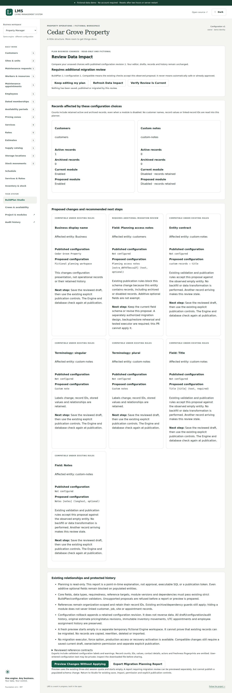
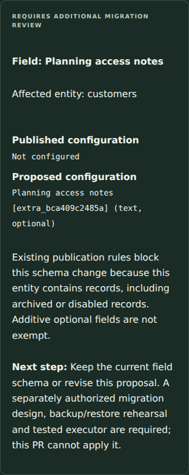

# Migration planning verification

PR #19 adds an authorized metadata observation and a read-only impact report. Applied migrations 1–12, RLS/grants, identity/recovery/lineage/checkpoint code, module contracts, BuildPlan/package v1/v2 formats, MIT licensing and ForgeOS attribution remain unchanged. Publication's existing storage checks are extracted into one helper shared with planning; its role, revision, rollback and populated-schema guards are retained.

## Coverage

- Five unit cases compare classifications against the existing `configurationImpact` rule for empty, active, archived and disabled records; optional field additions/type changes/removals, module retention, branding/version compatibility and immutable identity. Invalid schema/version pairs, altered core requiredness/types/references and missing dependencies refuse. Report export explicitly excludes transient state, counts, IDs and operational payloads.
- Four shared embedded/native cases exercise authorized counts, disabled populated entities, retained customer/site/task links and stock history, read-only snapshots/audits, rejected populated publication and compatible module publication/rollback. Freshness checks reject changes to source data even with unchanged counts, archive/restore, configuration, saved drafts and proposal; unrelated organizations and failed writes do not invalidate current reviews. Owners/admins succeed, staff/viewers/nonmembers and cross-organization draft claims refuse. Concurrent create/review observes a consistent before-or-after state; publication still refuses populated schema changes.
- Native PostgreSQL additionally refuses a retained repeatable-read transaction as freshness evidence. Existing real migration, failed-transaction, native backup/restore, recovery/credential/lineage/checkpoint and all module suites remain enabled without weaker assertions or activation gates.
- The demo integration case previews a migration-blocked proposal in a fresh empty Engine workspace without changing source data, drafts or histories.
- Two browser workflows run on desktop/tablet/phone: proposed customer fields, saved choice preservation, populated impact, data-only report download, actual Engine preview and field entry, module disabling with retained stock, explicit compatible publication/rollback, concurrent changes, verification failure, stale output refusal and invalid/foreign requests. Light/dark axe, keyboard confirmation and overflow checks are included.

## Reproduce

```sh
npm ci
npm run check
npx playwright install --with-deps chromium
npm run test:e2e
# Disposable fictional PostgreSQL prerequisites: docs/postgres-setup.md
npm run test:postgres
```

Actual local and final-source GitHub results are recorded in [PR #19](https://github.com/larrinamsalva/LMS/pull/19) and [its checks](https://github.com/larrinamsalva/LMS/pull/19/checks). Native tests fail rather than skip without prerequisites. Embedded results do not prove network concurrency or native backup behavior. Local native PostgreSQL/Docker are unavailable; the existing quality workflow uses PostgreSQL 16.15 and normal Playwright Chromium. Local browser verification uses the existing temporary Chromium 153 executable override.

Local Node 24.22.1 results:

| Check | Actual result |
| --- | --- |
| Final `npm run check` | 160 tests in 27 files, TypeScript, production build and 188 dependency license declarations passed |
| Full local responsive suite | 56/57 passed in 9.6 minutes, including all six new planning flows; one older ambiguous heading assertion corrected as described below |
| Corrected publication case | 3/3 desktop/tablet/phone passed in 44.5 seconds; final type check passed |
| Visual review | Actual desktop impact report and phone dark-mode field warning inspected |
| Native PostgreSQL | Unavailable locally; actual network results must come from the GitHub PostgreSQL job |

The first local production build failed loading an old Turbopack cache; generated files were preserved outside the repository and a clean build passed. The final full check also passed with the final field-summary changes. A missing temporary Chromium executable was restored from the existing local browser tools before browser verification. No application database, schema, records or security guard was modified to address these local environment issues.

The complete local browser run passed 56 of 57 cases in 9.6 minutes, including all six new planning viewport cases. One older tablet publication assertion ambiguously matched both the draft `h3` title and published `h1`. Its selector now explicitly targets the published level-1 heading, strengthening the actual publication check without changing behavior, guards, timeouts, quotas or skipped tests. The corrected case is verified on all three viewports separately; final-source GitHub CI reruns the complete suite. Actual desktop and phone dark-mode screenshots were visually inspected and retained below.

No production deployment, physical-device acceptance, external accessibility audit, migration execution, signed review receipt, real-user account activation or recovery activation is claimed.

## Application screenshots

Captured from the actual fictional application, not generated mockups.




