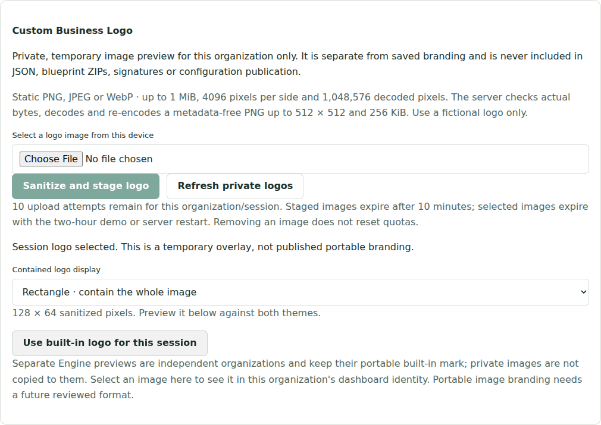
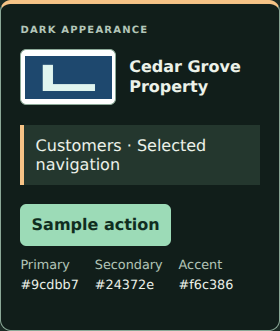

# Private logo verification

The new behavior is demo-only, with unchanged BusinessConfig, BuildPlan, ZIP and attestation protocols. No native PostgreSQL image persistence is implemented or claimed.

## Coverage

- Native Sharp decode/re-encode for synthetic PNG, JPEG and WebP, output bounds and metadata removal, unchanged caller bytes, hostile/SVG/HTML/GIF/TIFF input, malformed/truncated/polyglot containers, CRC corruption, byte/pixel/dimension/output limits, APNG and genuine two-frame WebP refusal.
- Private vault: staged/selected separation, explicit selection/replacement/layout/removal, stale edits, mismatched retry payloads, failed retries, global processing limits, session/upload/mutation quotas, cleanup after quota exhaustion, post-processing authority/expiry refusal and monotonic private revisions after expiry.
- Actual Next route handlers with real isolated demo Engine: cookie/origin/role checks, cross-session and cross-organization refusal, selected versus staged read permissions, metadata/content privacy, MIME spoofing, oversized raw bodies, unauthorized/unknown actions, expiry and preserved source records/audits/drafts/configuration. Both v1 and v2 ZIP bytes are compared before and after staging/selection.
- Actual responsive browser flow: device file selection, malformed image refusal, a supported image with misleading filename/MIME, light/dark samples, square/rectangle containment, explicit selection, source identity rendering, byte-identical v1 export, branded v2 export without assets, independent real Engine preview with no inherited image, replacement, old-ID refusal, broken-image fallback and return to built-ins. Axe/overflow checks run on desktop, tablet and phone.
- Existing foundation, native PostgreSQL/security/recovery/credential/publication, pricing, scheduling, workforce, inventory, template/history, branding, package, publisher-attestation, migration/readiness and backup/restore suites remain required. Applied SQL and protocol implementations are unchanged.

## Reproduce

```sh
npm ci
npm run check
npm exec playwright install --with-deps chromium
npm run test:e2e
# Disposable fictional PostgreSQL setup only, as documented in postgres.md:
npm run test:postgres
```

Use the existing PostgreSQL CI service for native evidence; PGlite tests are not a substitute for native database/restore tests. The PR's Checks and final description record actual source SHA, test counts and direct job links after completion. No native restore, real account or production-logo success is inferred from a synthetic fixture or browser screenshot.

All images in these tests are locally generated fictional raster pixels. The logo API never receives an image URL, test-trust override or signing key. No production customer image was uploaded and no service was deployed. PNG compressed metadata/profile chunks remain unsupported; native codec isolation/operational rate limits, durable real-business custody, portable versioned image branding and cross-organization preview copies remain separate follow-ups.

## Measured local results

After the interrupted environment was restored, TypeScript and **218 tests / 36 files** passed (55.91s), and **188** license declarations were verified. The interrupted Turbopack build cache was preserved outside the repository; a fresh production build then passed (3.4s compile, 7.4s TypeScript). This generated build cache is separate from business databases. No interrupted check is counted as a successful build.

The focused real browser workflow passed on all three viewports: **3 passed (37.8s)**, including axe/layout checks, protected image headers, authenticated/unauthenticated optimizer refusal, unchanged exports/source records, isolated Engine preview and broken-image fallback. Full browser and real PostgreSQL regression results, exact source SHA and direct CI job links are recorded in the PR description after completion. Native database/restore success is not inferred from the local PGlite or image tests.

Storage-reservation unit tests use a controlled maximum-size sanitizer result to exercise exact session/global quotas; the separate native raster tests exercise actual decode/re-encode. All browser images are synthetic colored pixels. The pinned read-only CI job also retains only `custom-logo-*.png` test captures in a `fictional-logo-previews` artifact for 30 days; it uploads no traces, cookies, dumps or production images.

## Captured screens

Actual temporary logo controls in desktop light mode:



Actual shared identity sample in phone dark mode, with the synthetic sanitized logo:



These captures were visually inspected after the workspace recovered. They demonstrate a temporary preview, not portable publication. The PR also retains [PR23's completed provenance evidence/screenshots](blueprint-provenance-verification.md), prepared after its source was merged externally; no attestation implementation changes are included in that follow-up. See [operator workflow and limits](private-logos.md).
