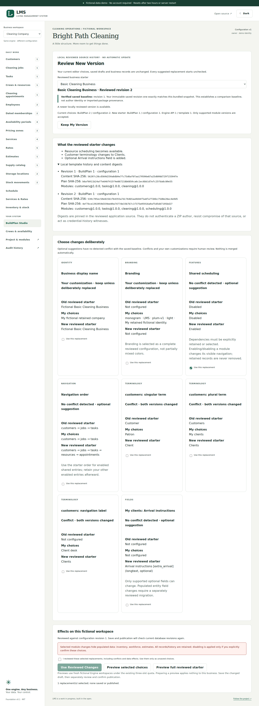
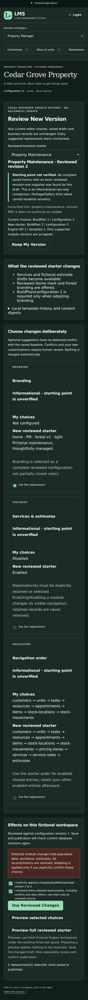

# Template history verification

PR #18 adds local immutable template snapshots and deliberate update review. No applied migration, engine permission, identity/recovery/credential/checkpoint path or operational module contract is modified. BuildPlan/configuration/package versions 1 and 2 remain unchanged.

## Coverage

- Unit cases validate seven frozen editions against declared readers, separately pinned SHA-256 content and the unchanged original Gallery entries. The frozen PR16 v1 ZIP still matches the original Basic Cleaning baseline. Altered or normalized history, repaired hashes, duplicate/missing entries, unknown versions/modules and injected code fields refuse.
- Baseline tests require an exact revision-one snapshot and complete saved chain. Changed roots, incomplete history, different industry/project identity and package hints do not establish ancestry. Detached copies cannot alter the registry. Three-way suggestions/conflicts/retained choices and unverified two-way comparisons are distinguished without implicit selection.
- Selection tests preserve customized name, terms, fields, branding and enabled modules, require explicit dependencies and format changes, enforce supported fields, and reject stale editor/configuration reviews, unsafe identity changes and populated-field migrations. JSON and package round trips retain compatible chosen configuration.
- Shared embedded/native PostgreSQL cases exercise explicit baseline/custom/update saves, identical retry audit counts, immutable roots, owner/admin authorization, staff/viewer rejection, cross-organization isolation, simultaneous stale saves, stale publication and rollback. Customers, disabled-module records, estimates, employee allocations and stock history/balances remain intact. Comparison/use alone writes no data. Existing native backup/restore and recovery suites continue to run without weakening their activation blockers.
- Two browser workflows run at desktop, tablet and phone sizes. They cover saved baseline review, keeping the old plan, migration refusal, selective changes, preserved branding/terms, real Engine preview, unsaved use, save/reopen/export, forged imported hints, explicit v1-to-v2 acknowledgement and publication/rollback. Axe, keyboard confirmation, light/dark readability and horizontal-overflow checks are included.

## Reproduce and evidence

```sh
npm ci
npm run check
npx playwright install --with-deps chromium
npm run test:e2e
# Disposable fictional native PostgreSQL prerequisites: docs/postgres-setup.md
npm run test:postgres
```

The existing quality workflow independently runs foundation, native PostgreSQL and browser jobs. [PR #18 checks](https://github.com/larrinamsalva/LMS/pull/18/checks) and its description record actual final-source CI evidence. Embedded PostgreSQL results alone are not evidence of network concurrency or native backup/restore. Native tests fail rather than skip when prerequisites are missing.

Actual local results on Node 24.22.1:

| Check | Result |
| --- | --- |
| `npm run check` | 150 tests in 26 files passed, plus TypeScript, production build and 188 dependency license declarations |
| Full responsive browser suite | 51 passed in 4.7 minutes, including all 45 previous cases and six new update-review viewport cases |
| Visual inspection | Desktop saved-baseline comparison and phone dark-mode compatibility review inspected; screenshots retained below |
| Protected boundaries | Applied migrations 1–12, server identity/recovery/credential/checkpoint code, dependencies, MIT license and ForgeOS reference unchanged |

Local browser checks use temporary Chromium 153.0.8010.0 through the existing Playwright executable override. Native PostgreSQL and Docker are unavailable locally; GitHub CI uses the repository's normal Playwright installation and PostgreSQL 16.15. Final implementation commit, CI run/job links and actual network test results are recorded in the PR description, separately from local PGlite evidence.

No production deployment, physical-device testing, external accessibility audit, authenticated template publisher, portable provenance guarantee, schema migration or recovery activation is claimed.

## Application screenshots

These screenshots are captured from the running fictional application, not generated mockups.




